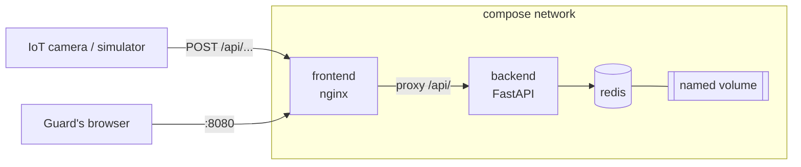

# Smart PortingLot

> Smart Parking License Plate Tracker, where the parking lot is a Cisco switch.
> Slots are ports, a parked car is a link in the `up` state, and the guard reads it all from `show parking-table`.

<!-- TODO: build badge once the workflow exists

-->

Track 2 (Full Stack DevOps) project for <course name>, <college>.

<!-- TODO: screenshot or GIF of the dashboard -->

## Contents

- [How it works](#how-it-works)
- [Quick start](#quick-start)
- [Services](#services)
- [API](#api)
- [Data persistence](#data-persistence)
- [CI/CD](#cicd)
- [The switch theme](#the-switch-theme)
- [Repository layout](#repository-layout)
- [Documentation](#documentation)
- [Team](#team)

## How it works



<!-- TODO: 3-5 sentences walking through one car entering:
camera POSTs the plate -> nginx proxies to the API -> API writes to Redis ->
dashboard JS polls GET and redraws the table. -->

Only the frontend is published to the host. The backend is reached through nginx at `/api/`, and Redis is reachable only from inside the compose network.

## Quick start

Requirements: Docker with the Compose plugin.

```sh
git clone https://github.com/<owner>/<repo>.git
cd <repo>
docker compose up -d --build
```

Dashboard: http://localhost:8080

Send a test car:

```sh
# TODO: adjust to the final endpoint and payload
curl -X POST http://localhost:8080/api/<endpoint> \
     -H 'Content-Type: application/json' \
     -d '{"plate": "12345678"}'
```

Stop:

```sh
docker compose down      # keeps the data
docker compose down -v   # also deletes the Redis volume
```

## Services

| Service    | Image / base                 | Port (container) | Published to host | Role |
|------------|------------------------------|------------------|-------------------|------|
| `frontend` | `nginx:stable-alpine`        | 80               | 8080              | Serves the dashboard, proxies `/api/` to the backend |
| `backend`  | `python:<pinned>-alpine`     | <port>           | no                | FastAPI: receives plates, serves lot state |
| `redis`    | `redis:<pinned>` (no Dockerfile) | 6379         | no                | Stores cars and lot state, persisted to a volume |
<!-- TODO: add a `camera` row if the simulator becomes its own container -->

### Configuration

| Variable | Service | Default | Meaning |
|----------|---------|---------|---------|
| `<VAR>`  | backend | `<value>` | <e.g. Redis host, lot capacity, hourly rate> |

## API

All routes are served under `/api/` through nginx.

| Method | Path | Body | Returns | Purpose |
|--------|------|------|---------|---------|
| POST   | `<path>` | `<json>` | `<status>` | Camera reports a car entering |
| GET    | `<path>` | none     | `<json>`   | Dashboard pulls current lot state |
| <TODO> | `<path>` | | | Release a car (`shutdown` on the port) |

<!-- TODO: error cases worth documenting: invalid plate, lot full (507), duplicate plate -->

Interactive docs (FastAPI): <TODO: URL if exposed through the proxy>

## Data persistence

<!-- TODO: fill in once compose is final -->

- Volume name: `<volume>` mounted at `/data` in the `redis` container.
- Redis persistence mode: <AOF / RDB>, and why.
- What is stored: <key layout, e.g. one hash per car, a counter, a sorted set>.

Prove it:

```sh
# 1. add a car, see it on the dashboard
docker compose down
docker compose up -d
# 2. the car is still there
```

## CI/CD

Workflow: `.github/workflows/<workflow>.yml`, runs on every push.

| Step | What it checks |
|------|----------------|
| Build | Both Dockerfiles build |
| <TODO: smoke test> | Stack comes up, POST then GET returns the car |
| <TODO: persistence test> | Data survives `down` / `up` |
| <TODO: lint> | hadolint, `docker compose config` |

### Images (bonus)

<!-- TODO: only if the GHCR push is implemented -->

Published to GitHub Container Registry on <trigger>:

- `ghcr.io/<owner>/<repo>-frontend:<tag>`
- `ghcr.io/<owner>/<repo>-backend:<tag>`

Tagging scheme: <TODO>

## The switch theme

| Parking lot | Switch |
|-------------|--------|
| Slot | Port (`Gi0/1` ...) |
| Car parked | Port `up` |
| Empty slot | Port `down` |
| License plate | Entry in the parking table |
| Lot full | No free ports |
| Release a car | `shutdown` on the port |

Example dashboard output:

```text
<TODO: paste real `show parking-table` output>
```

### Extras

<!-- TODO: list what actually ships: fee on release, 507 on full lot, syslog lines, easter egg (don't spoil it) -->

## Repository layout

```text
.
├── frontend/
│   ├── Dockerfile
│   ├── nginx.conf
│   └── <static files>
├── backend/
│   ├── Dockerfile
│   ├── requirements.txt
│   └── <app>
├── .github/workflows/<workflow>.yml
├── compose.yaml
├── AI_USAGE.md
├── <second doc>.md
└── README.md
```

## Documentation

- [AI_USAGE.md](AI_USAGE.md): prompts sent to AI tools, and what they got wrong.
- [<second doc>.md](<second doc>.md): <TODO: architecture decisions, pending confirmation of what the second required file is>.

## Team

| Name | GitHub | Worked on |
|------|--------|-----------|
| Tymofii Zhurida | [@xcv1h](https://github.com/xcv1h>) | Backend + GitHub Actions |
| Nathan Baleysh | [@mashmidnmalim23](https://github.com/mashmidnmalim23) | Frontend + Documentation |
