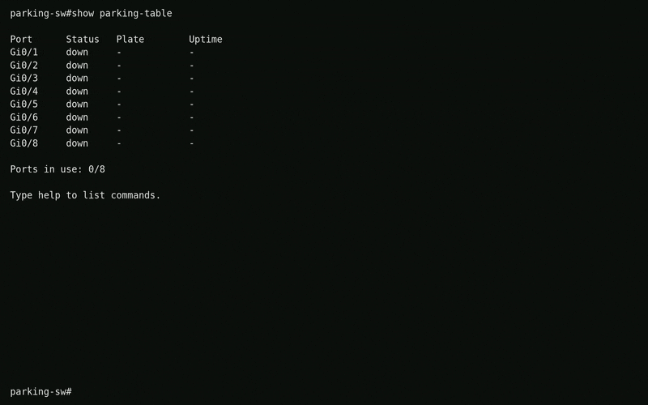
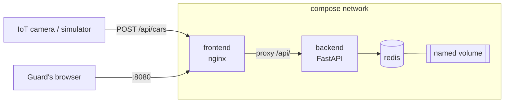

# Smart PortingLot

> Smart Parking License Plate Tracker, where the parking lot is a Cisco switch.
> Slots are ports, a parked car is a link in the `up` state, and the guard reads it all from `show parking-table`.


Track 2 (Full Stack DevOps) project for DevOps course, Kinneret College.



## Contents

- [How it works](#how-it-works)
- [Quick start](#quick-start)
- [Services](#services)
- [API](#api)
- [Data persistence](#data-persistence)
- [CI/CD](#cicd)
- [The switch theme](#the-switch-theme)
- [Repository layout](#repository-layout)
- [Documentation](#documentation)
- [Team](#team)

## How it works



One car entering, step by step:

1. The camera reads a plate and sends `POST /api/cars` with `{"plate": "123-45-678"}` to port 8080.
2. nginx strips the `/api` prefix and forwards the request to `backend:8000` inside the compose network.
3. The backend removes the dashes, checks that 7 or 8 digits are left, and runs one Lua script inside Redis that rejects a plate that is already parked, finds the lowest free port, and writes the car there in one atomic step (see [ARCHITECTURE.md](ARCHITECTURE.md#6-a-lua-script-for-parking-and-releasing)).
4. The dashboard polls `GET /api/ports` every 2 seconds, sees `Gi0/1` go from `down` to `up`, redraws the table and prints a syslog-style line.

Only the frontend is published to the host. The backend is reached through nginx at `/api/`, and Redis is reachable only from inside the compose network.

## Quick start

Requirements: Docker with the Compose plugin.

```sh
git clone https://github.com/xcv1h/Smart-PortingLot.git
cd Smart-PortingLot
docker compose up -d --build --wait
```

Dashboard: http://localhost:8080

Send a test car, then release it:

```sh
curl -X POST http://localhost:8080/api/cars \
     -H 'Content-Type: application/json' \
     -d '{"plate": "12345678"}'

curl -X DELETE http://localhost:8080/api/cars/12345678
```

Stop:

```sh
docker compose down      # keeps the data
docker compose down -v   # also deletes the Redis volume
```

## Services

| Service    | Image / base                 | Port (container) | Published to host | Role |
|------------|------------------------------|------------------|-------------------|------|
| `frontend` | `nginx:stable-alpine`        | 80               | 8080              | Serves the dashboard, proxies `/api/` to the backend |
| `backend`  | `python:3.13-alpine`         | 8000             | no                | FastAPI: receives plates, serves lot state |
| `redis`    | `redis:8.10-alpine` (no Dockerfile) | 6379      | no                | Stores cars and lot state, persisted to a volume |

The backend runs as a non-root user and the image holds only the app code and its three runtime dependencies (FastAPI, uvicorn, redis). Both `backend` and `redis` have healthchecks, and compose starts each service only once the one it depends on is healthy. The reasons behind these choices are in [ARCHITECTURE.md](ARCHITECTURE.md).

### Configuration

All variables are optional. They are read by the backend at startup.

| Variable        | Service | Default | Meaning |
|-----------------|---------|---------|---------|
| `REDIS_HOST`    | backend | `redis` | Hostname of the Redis service |
| `REDIS_PORT`    | backend | `6379`  | Port of the Redis service |
| `CAPACITY`      | backend | `8`     | Number of ports, named `Gi0/1` ... `Gi0/<CAPACITY>` |
| `RATE_PER_HOUR` | backend | `12.0`  | Parking fee per hour, charged pro rata by the second |

## API

All routes are served under `/api/` through nginx. Plates are 7 or 8 digits; dashes in the input are ignored, and plates are always returned as digits only. Timestamps are UTC, ISO 8601, with a trailing `Z`.

| Method | Path | Body | Returns | Purpose |
|--------|------|------|---------|---------|
| GET    | `/api/ports` | none | `200` `{"capacity": 8, "ports": [{"port": "Gi0/1", "plate": "12345678", "entered_at": "2026-11-10T12:00:00Z"}, {"port": "Gi0/2", "plate": null, "entered_at": null}, ...]}` | Dashboard pulls current lot state. Always lists every port, in order |
| POST   | `/api/cars` | `{"plate": "12345678"}` | `201` `{"port": "Gi0/1", "plate": "12345678", "entered_at": "..."}` | Camera reports a car entering. Gets the lowest free port |
| DELETE | `/api/cars/{plate}` | none | `200` `{"port": "Gi0/1", "plate": "12345678", "duration_seconds": 5400, "fee": 18.0}` | Release a car (`shutdown` on the port). `fee = duration_seconds / 3600 * RATE_PER_HOUR`, rounded to 2 decimals |
| GET    | `/api/health` | none | `200` `{"status": "ok"}` | Used by the compose healthcheck. `503` when Redis does not answer a PING |

Error responses always have the body `{"detail": "<one sentence>"}`:

| Status | When |
|--------|------|
| `404`  | `DELETE` of a plate that is not parked |
| `409`  | `POST` of a plate that is already parked |
| `422`  | Plate is not 7 or 8 digits, or the body is not `{"plate": "..."}` |
| `503`  | Redis is not reachable |
| `507`  | Lot is full: no free port |

Interactive docs (FastAPI): http://localhost:8080/api/docs

## Data persistence

- Volume name: `redis-data`, mounted at `/data` in the `redis` container.
- Redis persistence mode: AOF (`redis-server --appendonly yes`), so every write is on disk the moment it happens (why not snapshots: [ARCHITECTURE.md](ARCHITECTURE.md#8-aof-persistence-on-a-named-volume)).
- What is stored: one hash per **occupied** port, named after the port. A free port has no key at all, and the backend keeps nothing in memory (why this layout: [ARCHITECTURE.md](ARCHITECTURE.md#5-one-hash-per-occupied-port)).

```text
port:Gi0/1   hash   plate       digits only, e.g. "12345678"
                    entered_at  UTC, e.g. "2026-11-10T12:00:00Z"
```

Inspect it by hand:

```sh
docker compose exec redis redis-cli KEYS 'port:*'       # which ports are up
docker compose exec redis redis-cli HGETALL port:Gi0/1  # who is parked there, since when
```

Prove it:

```sh
# 1. add a car, see it on the dashboard
docker compose down
docker compose up -d --wait
# 2. the car is still there
```

## CI/CD

Workflow: `.github/workflows/ci.yml`, runs on every push and pull request.

| Step | What it checks |
|------|----------------|
| Lint | `docker compose config`, hadolint on both Dockerfiles |
| Unit tests | `pytest` in `backend/` against an in-memory Redis stand-in (no Redis server needed) |
| Build | Both images build from their Dockerfiles |
| Smoke test | `docker compose up --wait`, then `POST` a plate and `GET /api/ports` returns it |
| Persistence test | `docker compose down`, `up --wait` again, the plate is still there |

### Images (bonus)

<!-- TODO: only if the GHCR push is implemented -->

Published to GitHub Container Registry on <trigger>:

- `ghcr.io/xcv1h/smart-portinglot-frontend:<tag>`
- `ghcr.io/xcv1h/smart-portinglot-backend:<tag>`

Tagging scheme: <TODO>

## The switch theme

| Parking lot | Switch |
|-------------|--------|
| Slot | Port (`Gi0/1` ...) |
| Car parked | Port `up` |
| Empty slot | Port `down` |
| License plate | Entry in the parking table |
| Lot full | No free ports |
| Release a car | `shutdown` on the port |

Example dashboard output:

```text
parking-sw#show parking-table

Port      Status   Plate        Uptime
Gi0/1     up       123-45-678   01:30:00
Gi0/2     down     -            -
Gi0/3     up       76-543-21    00:05:12
Gi0/4     down     -            -
Gi0/5     down     -            -
Gi0/6     down     -            -
Gi0/7     down     -            -
Gi0/8     down     -            -

Ports in use: 2/8

*12:00:05: %PARK-5-UPDOWN: Slot Gi0/3, changed state to up (plate 76-543-21)
parking-sw#
```

The dashboard also takes commands: `help`, `show parking-table`, `park <plate>` and `shutdown <port>`.

### Extras

- Parking fee on release, charged by the second.
- `507 Insufficient Storage` when the lot is full, shown as a reverse-video `LOT FULL` alarm on the dashboard.
- Syslog-style lines in two places: the dashboard log in the browser, and the backend's stdout (`docker compose logs backend`), one line per car in, car out, and lot full.
- One easter egg in the dashboard. Park the right plate to find it.

## Repository layout

```text
.
├── frontend/
│   ├── Dockerfile
│   ├── nginx.conf          serves the static files, proxies /api/ to the backend
│   ├── index.html
│   ├── style.css
│   └── app.js              polling, table drawing, the command prompt
├── backend/
│   ├── Dockerfile
│   ├── requirements.txt    runtime dependencies, pinned
│   ├── requirements-dev.txt
│   ├── app/main.py         the whole API, key layout documented at the top
│   └── tests/test_api.py
├── .github/workflows/ci.yml
├── compose.yaml
├── AI_USAGE.md
├── ARCHITECTURE.md
└── README.md
```

Run the backend tests without Docker:

```sh
cd backend
pip install -r requirements-dev.txt
python -m pytest
```

## Documentation

- [AI_USAGE.md](AI_USAGE.md): prompts sent to AI tools, and what they got wrong.
- [ARCHITECTURE.md](ARCHITECTURE.md): architecture decisions, with the alternatives we did not take and why.

## Team

| Name | GitHub | Worked on |
|------|--------|-----------|
| Tymofii Zhurida | [@xcv1h](https://github.com/xcv1h) | Backend + Documentation |
| Nathan Baleysh | [@mashmidnmalim23](https://github.com/mashmidnmalim23) | Frontend + GitHub Actions |
